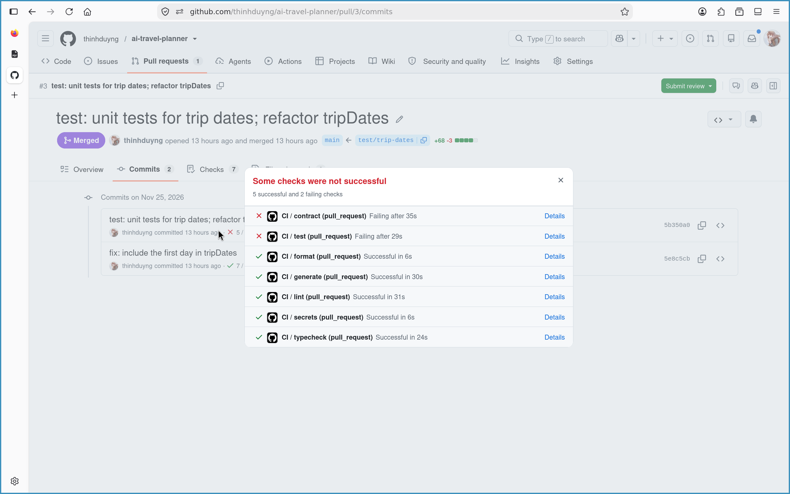
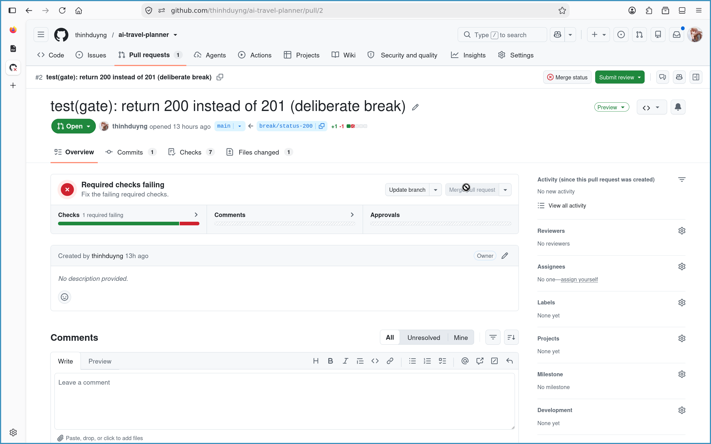
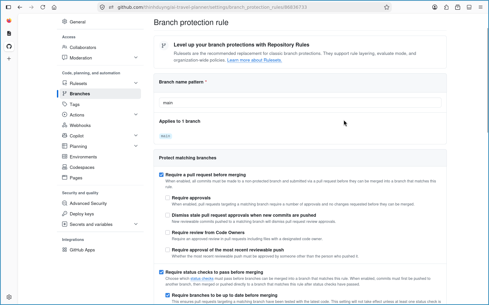

# PA2: The gate bites

Repository: https://github.com/thinhduyng/ai-travel-planner · submitted commit: tag [`pa2`](https://github.com/thinhduyng/ai-travel-planner/tree/pa2)

## Evidence

| What | Link |
|---|---|
| A pull request a red check stopped | [PR #3](https://github.com/thinhduyng/ai-travel-planner/pull/3): unit tests for trip dates plus a `tripDates` refactor with an off-by-one bug (day 1's date came back empty). Red commit [`5b350a0`](https://github.com/thinhduyng/ai-travel-planner/commit/5b350a0a6c5f50aab8a39977a5221e4d2dfb3d4a) |
| The failing run that blocked it | [run 45514941965](https://github.com/thinhduyng/ai-travel-planner/actions/runs/45514941965): jobs [`test`](https://github.com/thinhduyng/ai-travel-planner/actions/runs/45514941965/job/138871840637) and [`contract`](https://github.com/thinhduyng/ai-travel-planner/actions/runs/45514941965/job/138871840538) failed, so the merge was blocked |
| The commit that turned it green | [`5e8c5cb`](https://github.com/thinhduyng/ai-travel-planner/commit/5e8c5cbe389dd8b21db5641aba7e48846c6d05d7) `fix: include the first day in tripDates`, with all checks green ([run 45515180118](https://github.com/thinhduyng/ai-travel-planner/actions/runs/45515180118)). Merged as [`615f2f4`](https://github.com/thinhduyng/ai-travel-planner/commit/615f2f4959776061515d16262c13b2258c9e71f7) |
| A deliberate contract break that CI caught | [PR #2](https://github.com/thinhduyng/ai-travel-planner/pull/2): returns `200` instead of `201` (contract §2.1). Commit [`7ae42b1`](https://github.com/thinhduyng/ai-travel-planner/commit/7ae42b17e6b508d576e37aca1f0aaf5ad26db146) |
| The run that caught the break | [run 45513934539](https://github.com/thinhduyng/ai-travel-planner/actions/runs/45513934539), failing job [`contract`](https://github.com/thinhduyng/ai-travel-planner/actions/runs/45513934539/job/138868389859). Every other check stayed green |

PR #2 was never merged.

### Screenshots

PR #3: the red commit `5b350a0` with `test` and `contract` failing:

PR #2: merging blocked by the failing `contract` check:

## What was built

| Requirement | Where |
|---|---|
| Rules file for the assistant | [`CLAUDE.md`](CLAUDE.md) |
| Written permissions | [`.claude/settings.json`](.claude/settings.json): allow / ask / deny. Denies reading `.env`, editing contracts, workflows and generated code, force-push, `rm -rf` |
| No secrets in the history | [`.gitignore`](.gitignore) ignores `.env*`; [`.env.example`](.env.example) has placeholders only; the `secrets` CI job runs gitleaks over the **full** history on every PR and push |
| One command per check, same locally and in CI | [`Makefile`](Makefile); every CI job in [`.github/workflows/ci.yml`](.github/workflows/ci.yml) runs exactly one `make` target |
| Protected `main` with required checks | See below |
| Endpoint contract | [`docs/contract/create-itinerary.md`](docs/contract/create-itinerary.md) (rules, numbered §) + [`create-itinerary.openapi.yaml`](docs/contract/create-itinerary.openapi.yaml) (schema; Go types and routes are generated from it) |
| Contract tests in CI | [`api/contract/`](api/contract/): 36 tests over real HTTP, each named after its §; CI job `contract` |

### Commands

| Check | Local and CI command | CI job |
|---|---|---|
| Lint | `make lint` (golangci-lint, pinned) | `lint` |
| Format check | `make fmt-check` | `format` |
| Type check | `make typecheck` (`go vet`) | `typecheck` |
| Generated code up to date | `make generate-check` | `generate` |
| Unit tests | `make test` | `test` |
| Contract tests | `make contract` | `contract` |
| Secret scan | gitleaks | `secrets` |

### Branch protection on `main`

- Pull request required before merging; direct pushes blocked
- Required status checks (branch must be up to date): `lint`, `format`, `typecheck`, `generate`, `test`, `contract`, `secrets`
- Enforced for administrators
- Force pushes and branch deletion disabled

### Contract-first order

The contract landed before the code that implements it, in [PR #1](https://github.com/thinhduyng/ai-travel-planner/pull/1):
1. [`696bdf2`](https://github.com/thinhduyng/ai-travel-planner/commit/696bdf2): contract
2. [`f78f09e`](https://github.com/thinhduyng/ai-travel-planner/commit/f78f09e): contract tests, written before the implementation
3. [`d52534f`](https://github.com/thinhduyng/ai-travel-planner/commit/d52534f): implementation, all checks green ([run](https://github.com/thinhduyng/ai-travel-planner/actions/runs/45513455744))
